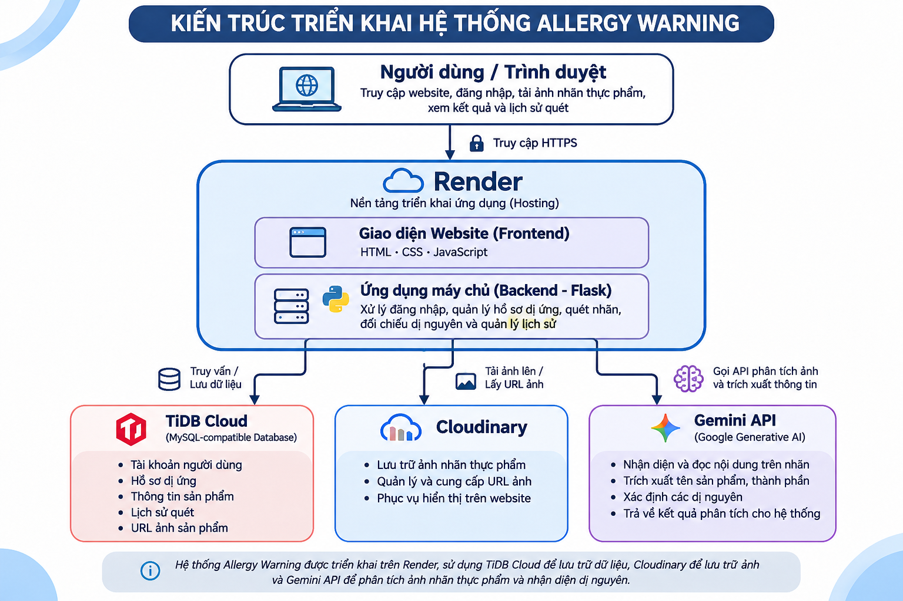
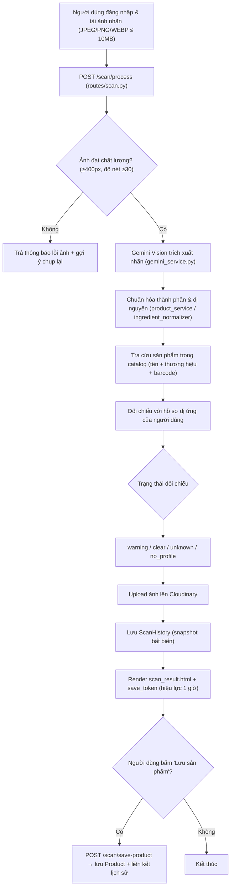
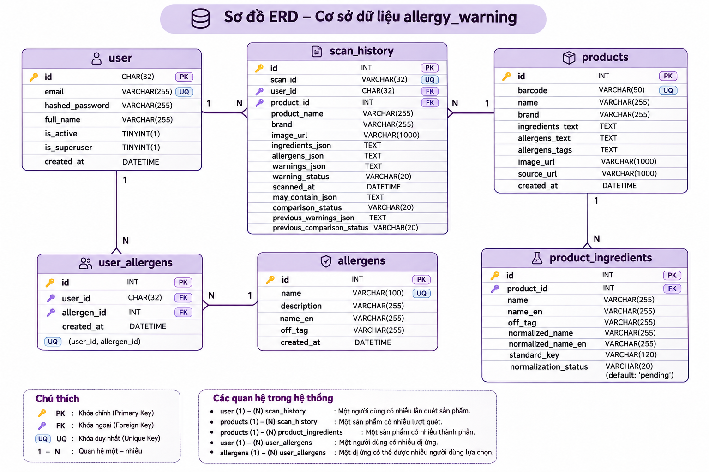
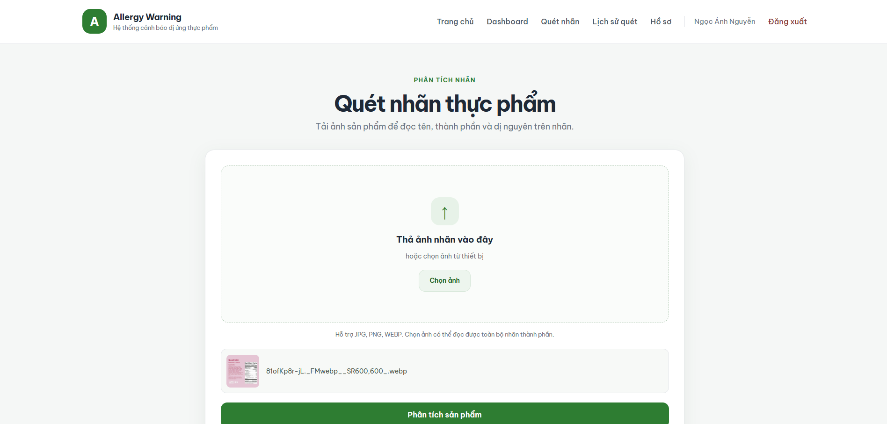
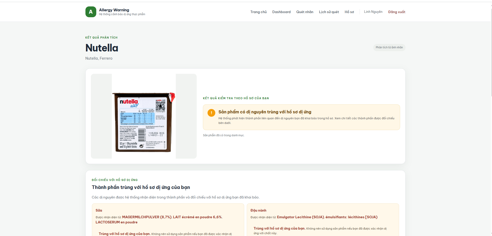
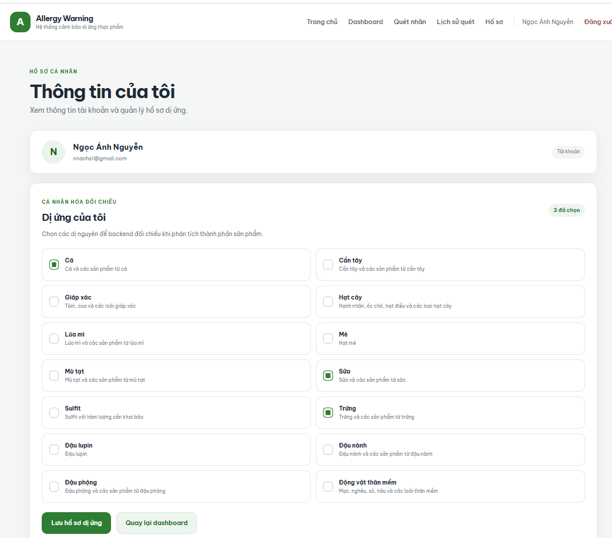
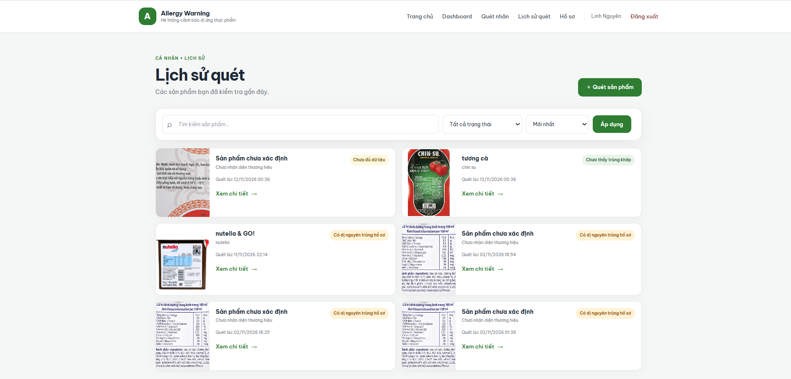
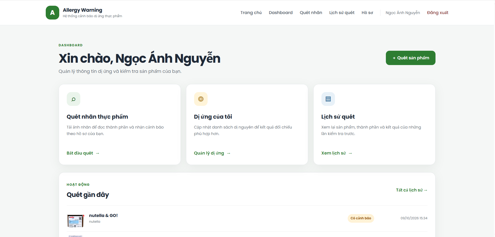
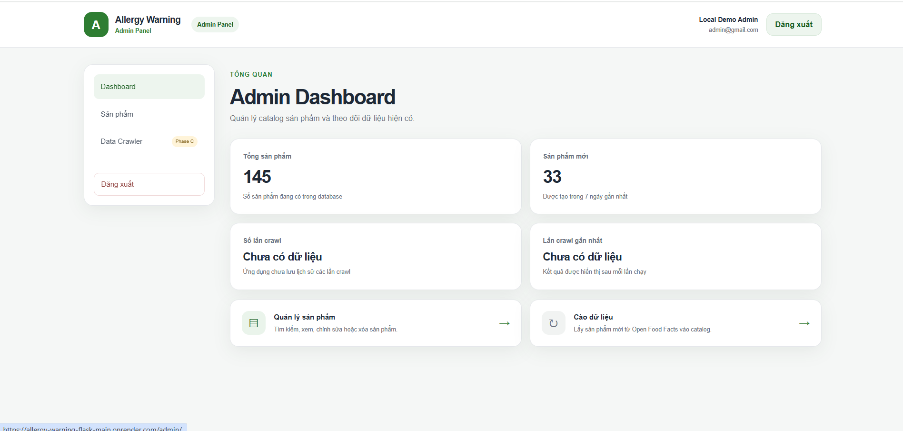

<div align="center">

# 🛡️ Allergy Warning — Hệ thống Đọc nhãn mác & Cảnh báo thành phần dị ứng thực phẩm

**Ứng dụng web Flask cho phép chụp ảnh nhãn thực phẩm, dùng Gemini để trích xuất thành phần, đối chiếu tự động với hồ sơ dị ứng cá nhân và cảnh báo ngay các thành phần nguy hiểm. Kết quả được lưu thành lịch sử quét, đồng thời bổ sung catalog sản phẩm từ Open Food Facts.**

[](https://www.python.org/)
[](https://flask.palletsprojects.com/)
[](https://ai.google.dev/)
[](#co-so-du-lieu)
[](./Dockerfile)

[Tổng quan](#tong-quan) •
[Tính năng](#tinh-nang) •
[Kiến trúc](#kien-truc-he-thong) •
[Cơ sở dữ liệu](#co-so-du-lieu) •
[Giao diện](#giao-dien) •
[Cài đặt & Khởi chạy](#cai-dat-va-khoi-chay) •
[Tài liệu API](#tai-lieu-api) •
[Kiểm thử](#kiem-thu)

</div>

---

## Mục lục

- [1. Tổng quan dự án](#tong-quan)
- [2. Tính năng nổi bật](#tinh-nang)
- [3. Kiến trúc hệ thống & Luồng xử lý](#kien-truc-he-thong)
- [4. Ngăn xếp công nghệ (Tech Stack)](#tech-stack)
- [5. Cơ sở dữ liệu](#co-so-du-lieu)
- [6. Giao diện hệ thống](#giao-dien)
- [7. Cấu trúc thư mục](#cau-truc-thu-muc)
- [8. Cài đặt & Khởi chạy](#cai-dat-va-khoi-chay)
- [9. Tài liệu API (Routes)](#tai-lieu-api)
- [10. Kiểm thử (Testing)](#kiem-thu)
- [11. Nạp dữ liệu & Crawler](#nap-du-lieu)
- [12. Giới hạn hiện tại & Hướng phát triển](#gioi-han-va-huong-phat-trien)
- [13. Đóng góp, Tài liệu tham khảo & Tác giả](#dong-gop-va-tac-gia)

---

<a id="tong-quan"></a>
## 1. Tổng quan dự án

**Allergy Warning** là hệ thống hỗ trợ người có cơ địa dị ứng thực phẩm kiểm tra nhanh một sản phẩm đóng gói có an toàn với mình hay không. Thay vì phải tự đọc bảng thành phần nhỏ và nhiều thuật ngữ, người dùng chỉ cần chụp ảnh nhãn mác; hệ thống tự đọc, chuẩn hóa thành phần và đối chiếu với danh sách dị nguyên mà người dùng đã khai báo trong hồ sơ.

### Bài toán & Cách tiếp cận
1. **Đọc nhãn bằng AI:** Ảnh nhãn được kiểm tra chất lượng cục bộ (kích thước, độ nét) rồi gửi tới **Google Gemini** để trích xuất tên sản phẩm, thương hiệu, danh sách thành phần, dị nguyên khai báo và cảnh báo "có thể chứa".
2. **Chuẩn hóa & đối chiếu có kiểm soát:** Thành phần được chuẩn hóa (bỏ dấu, bỏ phần trăm, khử trùng lặp) và ánh xạ bằng **từ điển bí danh có kiểm soát** — không dùng fuzzy matching để tự kết luận dị nguyên. Trường hợp không đủ căn cứ sẽ trả trạng thái `unknown` thay vì khẳng định "an toàn".
3. **Cá nhân hóa theo hồ sơ dị ứng:** Mỗi người dùng chọn các dị nguyên của mình (chuẩn theo taxonomy **Open Food Facts**); kết quả quét luôn được đối chiếu theo hồ sơ này.
4. **Lưu snapshot & catalog:** Mỗi lần quét được lưu thành bản ghi lịch sử bất biến để xem lại mà không gọi lại Gemini; sản phẩm có thể được lưu vào catalog dùng chung và bổ sung dữ liệu qua crawler Open Food Facts.

> ⚠️ **Lưu ý:** Kết quả chỉ mang tính hỗ trợ tham khảo, không thay thế tư vấn y tế. Hãy luôn xác minh trực tiếp trên nhãn sản phẩm.

---

<a id="tinh-nang"></a>
## 2. Tính năng nổi bật

- **Quét nhãn bằng ảnh (Gemini Vision):** Hỗ trợ ảnh `JPEG` / `PNG` / `WEBP` tối đa **10 MB**, có cơ chế thử lại (retry) khi gặp lỗi tạm thời và phân loại lỗi rõ ràng (cấu hình, ảnh không hợp lệ, phản hồi sai định dạng).
- **Kiểm tra chất lượng ảnh trước khi gọi AI:** Từ chối ảnh quá nhỏ (cạnh ngắn < `400 px`) hoặc quá mờ (phương sai Laplacian < `30`) để tránh trích xuất sai và tiết kiệm lượt gọi API.
- **Cảnh báo dị ứng cá nhân hóa:** Đối chiếu thành phần và dị nguyên khai báo với hồ sơ người dùng, trả về 4 trạng thái: `warning` (có dị nguyên), `clear` (không phát hiện), `unknown` (thiếu căn cứ kết luận), `no_profile` (chưa khai báo hồ sơ).
- **Phân biệt "chứa" và "có thể chứa":** Cảnh báo *may contain / traces* được lưu riêng, cho phép đối chiếu lại khi người dùng thay đổi hồ sơ dị ứng.
- **Lịch sử quét:** Danh sách có tìm kiếm theo tên/thương hiệu, lọc trạng thái, sắp xếp thời gian và phân trang; truy vấn luôn giới hạn theo `user_id` trong session nên tài khoản này không xem được lịch sử của tài khoản khác.
- **Kiểm tra theo mã vạch:** Tra cứu sản phẩm đã có trong catalog bằng barcode và đối chiếu ngay với hồ sơ.
- **Khu vực quản trị (Admin):** Dashboard thống kê, quản lý (xem / sửa / xóa) sản phẩm, kích hoạt crawler Open Food Facts; mọi thao tác ghi đều có **CSRF token** và kiểm tra quyền `is_superuser` trên từng request.
- **Lưu ảnh trên đám mây:** Ảnh quét được tải lên **Cloudinary** để lưu URL HTTPS vào database, không phụ thuộc vào ổ đĩa của server.
- **Vận hành linh hoạt:** Chạy local bằng Flask, triển khai bằng Gunicorn / Docker, kết nối database có xác thực SSL (TiDB Cloud / MySQL).

---

<a id="kien-truc-he-thong"></a>
## 3. Kiến trúc hệ thống & Luồng xử lý





### Chi tiết các tham số kỹ thuật chính
| Tham số | Giá trị | Vị trí | Vai trò |
| :--- | :--- | :--- | :--- |
| `MAX_CONTENT_LENGTH` | `10 MB` | `config.py` | Giới hạn kích thước ảnh tải lên (`HTTP 413` nếu vượt) |
| `ALLOWED_EXTENSIONS` | `png`, `jpg`, `jpeg`, `webp` | `config.py` | Định dạng ảnh được chấp nhận |
| `MIN_SHORT_SIDE` | `400 px` | `services/image_quality_service.py` | Cạnh ngắn tối thiểu của ảnh |
| `BLUR_THRESHOLD` | `30.0` | `services/image_quality_service.py` | Ngưỡng phương sai Laplacian để phát hiện ảnh mờ |
| `GEMINI_MODEL` | `gemini-3.5-flash-lite` | `services/gemini_service.py` | Mô hình dùng để đọc nhãn |
| `SCAN_SAVE_SALT` / `max_age` | `3600 s` | `routes/scan.py` | Token ký số cho nút "Lưu sản phẩm", hết hạn sau 1 giờ |
| `PER_PAGE` | `10` / `20` | `routes/history.py` / `routes/admin.py` | Số dòng mỗi trang của lịch sử / danh sách sản phẩm admin |
| Connection pool | `pool_size=5`, `max_overflow=10`, `pool_recycle=1800` | `app.py` | Cấu hình SQLAlchemy, bật `pool_pre_ping` |

---

<a id="tech-stack"></a>
## 4. Ngăn xếp công nghệ (Tech Stack)

| Tầng hệ thống | Công nghệ & Thư viện |
| :--- | :--- |
| **AI / Xử lý ảnh** | `google-genai 2.28.0` (Gemini), `Pillow 12.3.0`, `pytesseract 0.3.13` (OCR Tesseract tùy chọn) |
| **Backend** | `Python 3.10+`, `Flask 3.1.2`, `Flask-SQLAlchemy 3.1.1`, `Gunicorn`, `python-dotenv` |
| **Cơ sở dữ liệu** | `MySQL / TiDB Cloud` qua `PyMySQL 1.1.2` (kết nối SSL, xác thực chứng chỉ) |
| **Dịch vụ ngoài** | `Google Gemini API`, `Open Food Facts API` (`requests 2.34.2`), `Cloudinary` |
| **Frontend** | `Jinja2 Templates`, `HTML5`, `CSS3`, `Vanilla JavaScript` (`static/app.js`, `static/style.css`) |
| **Triển khai & Kiểm thử** | `Docker`, `Gunicorn`, `pytest` |

---

<a id="co-so-du-lieu"></a>
## 5. Cơ sở dữ liệu



### 5.1. Các bảng chính (`models.py`)

| Bảng | Model | Vai trò |
| :--- | :--- | :--- |
| `user` | `User` | Tài khoản (`id` dạng `CHAR(32)` UUID hex, email duy nhất, mật khẩu băm, cờ `is_active`, `is_superuser`) |
| `allergens` | `Allergen` | Danh mục dị nguyên chuẩn (tên Việt/Anh, `off_tag` theo Open Food Facts) |
| `user_allergens` | `UserAllergen` | Hồ sơ dị ứng của từng người dùng (ràng buộc duy nhất `user_id` + `allergen_id`) |
| `products` | `Product` | Catalog sản phẩm: barcode, tên, thương hiệu, thành phần, dị nguyên, ảnh, nguồn |
| `product_ingredients` | `ProductIngredient` | Thành phần tách riêng từng dòng, kèm kết quả chuẩn hóa (`normalized_name`, `standard_key`, `normalization_status`) |
| `scan_history` | `ScanHistory` | Snapshot từng lần quét: thành phần, dị nguyên, cảnh báo, "có thể chứa", trạng thái đối chiếu, thời điểm quét |

### 5.2. Quy ước dữ liệu quan trọng
- `user.id` và `user_allergens.user_id` cùng kiểu `CHAR(32)` để khóa ngoại khớp nhau; script khởi tạo kiểm tra các cột bắt buộc và độ dài ID trước khi tạo bảng.
- `ScanHistory` lưu dữ liệu dạng JSON (`ingredients_json`, `allergens_json`, `warnings_json`, `may_contain_json`) để xem lại mà **không cần gọi lại Gemini**.
- Khi hồ sơ dị ứng thay đổi, hệ thống giữ snapshot cảnh báo trước đó (`previous_warnings_json`, `previous_comparison_status`) để so sánh.
- Nếu sản phẩm chưa có trong catalog, lịch sử vẫn được lưu; khi người dùng bấm **Lưu sản phẩm**, bản ghi lịch sử được liên kết tới sản phẩm vừa tạo (`product_id` dùng `ON DELETE SET NULL`).
- Thời gian lưu theo UTC và được chuyển sang múi giờ `Asia/Ho_Chi_Minh` khi hiển thị (filter `vn_datetime`).

---

<a id="giao-dien"></a>
## 6. Giao diện hệ thống

| Quét nhãn | Kết quả cảnh báo |
| :---: | :---: |
|  |  |

| Hồ sơ dị ứng | Lịch sử quét |
| :---: | :---: |
|  |  |

| Dashboard người dùng | Dashboard quản trị |
| :---: | :---: |
|  |  |

> Các sơ đồ Use Case, Activity, Sequence và ERD đầy đủ nằm trong thư mục [`Do_an/assets/`](Do_an/assets/) và báo cáo [`Do_an/do-an.pdf`](Do_an/do-an.pdf).

---

<a id="cau-truc-thu-muc"></a>
## 7. Cấu trúc thư mục

```text
allergy-warning-flask-main/
├── app.py                             # Khởi tạo Flask, cấu hình DB pool, đăng ký 7 Blueprint, filter múi giờ VN
├── config.py                          # Đọc .env: SECRET_KEY, kết nối DB (SSL), upload, Tesseract
├── extensions.py                      # Đối tượng SQLAlchemy dùng chung
├── models.py                          # User, Allergen, UserAllergen, Product, ProductIngredient, ScanHistory
├── create_product_tables.py           # Tạo các bảng còn thiếu (db.create_all, không reset dữ liệu)
├── seed_allergens.py                  # Nạp taxonomy dị nguyên từ Open Food Facts
├── requirements.txt                   # Thư viện Python
├── Dockerfile                         # Image Python 3.11 + Tesseract, chạy bằng Gunicorn
├── pytest.ini                         # Cấu hình pytest (thư mục tests/)
├── .env.example                       # Mẫu biến môi trường
│
├── routes/                            # Các Blueprint (controller)
│   ├── main.py                        # Trang chủ `/` và dashboard người dùng
│   ├── auth.py                        # Đăng ký / đăng nhập / đăng xuất
│   ├── profile.py                     # Hồ sơ cá nhân & chọn dị nguyên
│   ├── scan.py                        # Quét nhãn: /scan, /scan/process, /scan/save-product
│   ├── product.py                     # Kiểm tra sản phẩm theo barcode
│   ├── history.py                     # Danh sách & chi tiết lịch sử quét
│   └── admin.py                       # Quản trị: dashboard, sản phẩm, crawler (CSRF + phân quyền)
│
├── services/                          # Logic nghiệp vụ
│   ├── gemini_service.py              # Gọi Gemini, retry, chẩn đoán lỗi, chuẩn hóa phản hồi JSON
│   ├── image_quality_service.py       # Kiểm tra kích thước & độ nét ảnh
│   ├── product_service.py             # Chuẩn hóa thành phần, tìm sản phẩm, đối chiếu dị nguyên
│   ├── ingredient_normalizer.py       # Từ điển bí danh thành phần có kiểm soát
│   ├── allergy_service.py             # Nhận diện dị nguyên theo từ khóa
│   ├── history_service.py             # Lưu snapshot lịch sử quét (chống trùng)
│   ├── cloudinary_service.py          # Upload ảnh quét lên Cloudinary
│   ├── off_service.py                 # Lấy taxonomy dị nguyên từ Open Food Facts
│   └── ocr_service.py                 # OCR Tesseract (tùy chọn)
│
├── crawler/
│   └── openfoodfacts_crawler.py       # Cào sản phẩm & thành phần từ Open Food Facts API
│
├── templates/                         # Giao diện Jinja2 (người dùng + admin/)
├── static/                            # app.js, style.css (static/uploads/ bị bỏ qua trong .gitignore)
├── certs/isrgrootx1.pem               # Chứng chỉ gốc để xác thực SSL khi kết nối TiDB Cloud
│
├── scripts/                           # Script tiện ích
│   ├── create_admin.py                # Tạo tài khoản admin demo cục bộ
│   ├── normalize_existing_ingredients.py  # Chuẩn hóa lại thành phần đã lưu
│   └── debug_gemini_runtime.py, test_gemini_*.py, test_scan_http.py   # Công cụ gỡ lỗi Gemini/scan
│
├── tests/                             # Bộ test pytest (admin, allergen, crawler, gemini, history, scan upload...)
├── docs/agents/                       # Ghi chú quy trình làm việc cho công cụ hỗ trợ (AGENTS.md)
└── Do_an/                             # Báo cáo đồ án (LaTeX/PDF), sơ đồ UML, ảnh giao diện (assets/)
```

---

<a id="cai-dat-va-khoi-chay"></a>
## 8. Cài đặt & Khởi chạy

> [!IMPORTANT]
> **Không commit `.env` hoặc API key lên Git.** File `.env` đã được loại trừ trong `.gitignore`; chỉ commit file mẫu `.env.example`.

### Yêu cầu hệ thống
- **Python 3.10+** (Docker dùng Python 3.11)
- **MySQL / MariaDB / TiDB Cloud** có hỗ trợ kết nối SSL (cấu hình hiện tại bắt buộc xác thực chứng chỉ)
- Khóa **`GEMINI_API_KEY`** để đọc nhãn bằng AI
- Tài khoản **Cloudinary** (cloud name, API key, API secret) để lưu ảnh quét
- *(Tùy chọn)* **Tesseract OCR** nếu muốn dùng `services/ocr_service.py`

### Bước 1: Clone repository & tạo môi trường ảo

```bash
git clone https://github.com/Ducbao1309/allergy-warning-flask-main.git
cd allergy-warning-flask-main
```

**Windows (PowerShell):**
```powershell
python -m venv .venv
.\.venv\Scripts\Activate.ps1
python -m pip install --upgrade pip
python -m pip install -r requirements.txt
Copy-Item .env.example .env
```

**Linux / macOS:**
```bash
python3 -m venv .venv
source .venv/bin/activate
pip install --upgrade pip
pip install -r requirements.txt
cp .env.example .env
```

### Bước 2: Cấu hình biến môi trường (`.env`)

`config.py` đọc các biến sau (tham khảo `.env.example`):

```dotenv
# Flask
SECRET_KEY=replace-with-a-long-random-secret

# Database (TiDB Cloud / MySQL có SSL)
DB_HOST=your-db-host
DB_PORT=4000
DB_USER=your-db-user
DB_PASSWORD=your-db-password
DB_NAME=food_allergen_system
DB_SSL_CA=certs/isrgrootx1.pem

# Gemini
GEMINI_API_KEY=your-gemini-api-key

# Cloudinary
CLOUDINARY_CLOUD_NAME=your-cloud-name
CLOUDINARY_API_KEY=your-api-key
CLOUDINARY_API_SECRET=your-api-secret

# Tesseract OCR (tùy chọn)
# TESSERACT_CMD="C:/Program Files/Tesseract-OCR/tesseract.exe"
```

| Biến | Bắt buộc | Ý nghĩa |
| :--- | :---: | :--- |
| `SECRET_KEY` | ✅ | Khóa ký session và token "Lưu sản phẩm" |
| `DB_HOST`, `DB_USER`, `DB_PASSWORD`, `DB_NAME` | ✅ | Thông tin kết nối database |
| `DB_PORT` | — | Cổng database (mặc định `4000`) |
| `DB_SSL_CA` | — | Đường dẫn chứng chỉ CA (mặc định `certs/isrgrootx1.pem`) |
| `GEMINI_API_KEY` | ✅ | Khóa Gemini API để phân tích ảnh nhãn |
| `CLOUDINARY_CLOUD_NAME`, `CLOUDINARY_API_KEY`, `CLOUDINARY_API_SECRET` | ✅ | Upload ảnh quét lên Cloudinary |
| `TESSERACT_CMD` | — | Đường dẫn Tesseract (chỉ khi dùng OCR) |

### Bước 3: Khởi tạo database

Tạo sẵn database (ví dụ `food_allergen_system`), sau đó chạy:

```bash
python create_product_tables.py
```

Script dùng `db.create_all()`, **chỉ tạo bảng còn thiếu và không thay đổi cấu trúc bảng hiện có** — không cần xóa/reset database. Với database tạo trước khi có tính năng lịch sử, chạy script này một lần để sinh bảng `scan_history`.

Sau đó nạp danh mục dị nguyên chuẩn:

```bash
python seed_allergens.py
```

### Bước 4: Chạy ứng dụng

```bash
python app.py
```

Mở trình duyệt tại **<http://127.0.0.1:5000>**.

**Chạy bằng Gunicorn (Linux / macOS):**
```bash
gunicorn app:app --bind 0.0.0.0:5000 --timeout 120
```

### Bước 5 (tùy chọn): Tạo tài khoản quản trị

```bash
python scripts/create_admin.py
```

Script tạo/cập nhật tài khoản `admin@gmail.com` (mật khẩu `1234`) với quyền `is_superuser` — **chỉ dành cho demo cục bộ**, tuyệt đối không dùng trên môi trường thật. Truy cập khu vực quản trị tại `/admin/` sau khi đăng nhập.

### Chạy bằng Docker

```bash
docker build -t allergy-warning-flask .
docker run -d -p 10000:10000 --env-file .env --name allergy_warning allergy-warning-flask
```

Ứng dụng lắng nghe tại **<http://localhost:10000>** (cổng mặc định `10000`, có thể đổi bằng biến `PORT`). Image đã cài sẵn `tesseract-ocr` (gói ngôn ngữ `eng`, `vie`) và chạy bằng Gunicorn với `--timeout 120 --graceful-timeout 30 --keep-alive 5`.

---

<a id="tai-lieu-api"></a>
## 9. Tài liệu API (Routes)

Ứng dụng render giao diện phía server; các route chính như sau. Hầu hết yêu cầu **đăng nhập** (chưa đăng nhập sẽ được chuyển về `/login`).

### 9.1. Người dùng

| Phương thức | Endpoint | Mô tả |
| :---: | :--- | :--- |
| `GET` | `/` | Trang chủ |
| `GET` | `/dashboard` | Bảng điều khiển cá nhân, hiển thị 5 lần quét gần nhất |
| `GET` `POST` | `/register` | Đăng ký tài khoản |
| `GET` `POST` | `/login` | Đăng nhập |
| `GET` | `/logout` | Đăng xuất |
| `GET` `POST` | `/profile/` | Xem / cập nhật hồ sơ và danh sách dị nguyên |
| `GET` | `/scan/` | Trang tải ảnh nhãn |
| `POST` | `/scan/process` | Nhận ảnh (`multipart/form-data`, trường `image`), phân tích & đối chiếu, trả trang kết quả |
| `POST` | `/scan/save-product` | Lưu sản phẩm vừa quét vào catalog (cần `save_token` còn hiệu lực) |
| `GET` `POST` | `/product/check` | Kiểm tra sản phẩm theo barcode |
| `GET` | `/history/` | Danh sách lịch sử quét (tìm kiếm, lọc, sắp xếp, phân trang) |
| `GET` | `/history/<id>` | Chi tiết một lần quét đã lưu |
| `GET` | `/scan/debug-upload` | Trang thử upload phục vụ gỡ lỗi |

### 9.2. Quản trị (`/admin`, yêu cầu `is_superuser`)

| Phương thức | Endpoint | Mô tả |
| :---: | :--- | :--- |
| `GET` | `/admin/` | Dashboard thống kê |
| `GET` | `/admin/crawler` | Trang điều khiển crawler |
| `POST` | `/admin/crawler/start` | Bắt đầu cào dữ liệu Open Food Facts |
| `GET` | `/admin/products` | Danh sách sản phẩm (20 dòng/trang) |
| `GET` | `/admin/products/<id>` | Chi tiết sản phẩm |
| `GET` `POST` | `/admin/products/<id>/edit` | Chỉnh sửa sản phẩm |
| `POST` | `/admin/products/<id>/delete` | Xóa sản phẩm |
| `POST` | `/admin/logout` | Đăng xuất khu vực quản trị |

> Mọi request `POST` của khu vực admin đều bắt buộc có `csrf_token` hợp lệ, nếu không sẽ trả `400`.

### 9.3. Giới hạn & mã lỗi thường gặp
- `413 Payload Too Large`: Ảnh vượt quá `10 MB`.
- `403 Forbidden`: Tài khoản không có quyền quản trị (`is_superuser`) hoặc đã bị vô hiệu hóa.
- `400 Bad Request`: Thiếu / sai `csrf_token` ở khu vực admin.
- `503 Service Unavailable`: Không thể truy vấn database (hiển thị trang lỗi thân thiện thay vì làm sập ứng dụng).
- Ảnh sai định dạng, quá nhỏ hoặc quá mờ sẽ được từ chối kèm thông báo gợi ý chụp lại.

---

<a id="kiem-thu"></a>
## 10. Kiểm thử (Testing)

Bộ test pytest nằm trong thư mục [`tests/`](tests/) (cấu hình tại `pytest.ini`):

| File | Phạm vi kiểm thử |
| :--- | :--- |
| `test_allergen_matching.py` | Đối chiếu thành phần với dị nguyên (cụm từ tiếng Việt, tránh khớp nhầm chuỗi con) |
| `test_product_matching.py` | Tìm và khớp sản phẩm trong catalog |
| `test_gemini_service.py` | Prompt, chuẩn hóa phản hồi và xử lý lỗi của Gemini service |
| `test_scan_upload.py` | Luồng tải ảnh `/scan/process` với Gemini được mock (PNG/WEBP, ảnh nhỏ, ảnh mờ) |
| `test_history.py` | Lịch sử quét, phân quyền theo người dùng |
| `test_crawler.py` | Crawler Open Food Facts: lưu dữ liệu, phân trang, kiểm tra trường hợp lỗi |
| `test_admin.py` | Phân quyền admin, CSRF, quản lý sản phẩm |

Chạy kiểm thử:

```bash
pip install pytest
pytest -v
```

> **Ghi chú:** Các test dùng Gemini giả lập (mock) nên không tốn lượt gọi API; cần có file `.env` hợp lệ (ít nhất `SECRET_KEY` và thông tin `DB_*`) để ứng dụng khởi tạo được. Một số test tích hợp (lịch sử quét, tải ảnh, crawler) đang cần được cập nhật cho khớp với các thay đổi gần nhất của mã nguồn.

---

<a id="nap-du-lieu"></a>
## 11. Nạp dữ liệu & Crawler

| Lệnh | Tác dụng |
| :--- | :--- |
| `python create_product_tables.py` | Tạo các bảng còn thiếu, kiểm tra kiểu cột khóa ngoại |
| `python seed_allergens.py` | Tải taxonomy dị nguyên từ Open Food Facts vào bảng `allergens` |
| `python crawler/openfoodfacts_crawler.py` | Nạp catalog sản phẩm & thành phần từ Open Food Facts |
| `python scripts/normalize_existing_ingredients.py` | Chuẩn hóa lại thành phần của các sản phẩm đã lưu |

Crawler cũng có thể được kích hoạt từ giao diện quản trị tại `/admin/crawler`. Các thông số chính của crawler (`crawler/openfoodfacts_crawler.py`):

- Dữ liệu lấy **trực tiếp từ API Open Food Facts** (không dùng bản dump), `20` sản phẩm/trang.
- Tối đa `10` trang và `100` sản phẩm mới mỗi lần chạy.
- Giãn cách tối thiểu `6.5 s` giữa các request, thử lại tối đa `4` lần với mã lỗi `429/500/502/503/504` để tránh bị giới hạn tốc độ.
- Lưu trạng thái tiến độ vào `crawler/.openfoodfacts_crawler_state.json` để tiếp tục ở lần chạy sau.
- Chống trùng sản phẩm theo **barcode** (định danh ổn định trên Open Food Facts); sản phẩm cùng tên nhưng khác quy cách/hương vị vẫn được lưu riêng. Thành phần được khử trùng theo thẻ OFF hoặc tên chuẩn hóa.

> Các script nạp dữ liệu cần database đã cấu hình và kết nối Internet.

---

<a id="gioi-han-va-huong-phat-trien"></a>
## 12. Giới hạn hiện tại & Hướng phát triển

### Giới hạn đã ghi nhận
- **Phụ thuộc dịch vụ ngoài:** Chức năng quét nhãn cần Internet và hạn mức của Gemini API; khi API quá tải hoặc hết quota, hệ thống trả lỗi dịch vụ và người dùng cần thử lại sau.
- **Chất lượng ảnh quyết định độ chính xác:** Nhãn bị lóa, cong, chữ quá nhỏ hoặc in mờ có thể khiến AI bỏ sót thành phần; ảnh không đạt ngưỡng chất lượng sẽ bị từ chối.
- **Từ điển chuẩn hóa có kiểm soát:** Thành phần chưa có trong từ điển bí danh được giữ nguyên văn bản gốc và đánh dấu chưa khớp; hệ thống ưu tiên trả `unknown` hơn là kết luận thiếu căn cứ.
- **Tốc độ nạp catalog:** Crawler bị giãn cách request để tuân thủ giới hạn của Open Food Facts nên nạp dữ liệu số lượng lớn tốn thời gian.
- **Chỉ mang tính tham khảo:** Kết quả không thay thế tư vấn y tế và không đảm bảo thay cho việc đọc nhãn trực tiếp.

### Hướng phát triển
- [ ] Quét **mã vạch bằng camera** và tra cứu trực tiếp trên Open Food Facts khi sản phẩm chưa có trong catalog.
- [ ] Mở rộng từ điển bí danh thành phần và bổ sung nhiều dị nguyên phổ biến tại Việt Nam.
- [ ] Hỗ trợ **đa ngôn ngữ nhãn** (Anh, Việt, Hàn, Nhật...) với kiểm thử riêng cho từng ngôn ngữ.
- [ ] Đóng gói giao diện thành **PWA / ứng dụng di động** để chụp và quét thuận tiện hơn.
- [ ] Bổ sung **GitHub Actions CI** tự chạy `pytest` cho mỗi Pull Request.
- [ ] Cập nhật bộ test tích hợp cho khớp với các thay đổi mới nhất và bổ sung `.env.example` theo đúng biến mà `config.py` sử dụng.

---

<a id="dong-gop-va-tac-gia"></a>
## 13. Đóng góp, Tài liệu tham khảo & Tác giả

### Đóng góp (Contributing)
Mọi đóng góp nhằm cải thiện độ chính xác hoặc trải nghiệm người dùng đều được hoan nghênh:
1. **Fork** repository này.
2. Tạo nhánh tính năng mới: `git checkout -b feat/ten-tinh-nang`.
3. Commit thay đổi theo chuẩn Conventional Commits: `git commit -m "feat: mô tả ngắn gọn thay đổi"`.
4. Push lên nhánh của bạn (`git push origin feat/ten-tinh-nang`) và tạo **Pull Request**.

### Nguồn dữ liệu & Tham khảo
- **[Open Food Facts](https://world.openfoodfacts.org/)** — taxonomy dị nguyên và dữ liệu sản phẩm (API công khai)
- **[Google Gemini API](https://ai.google.dev/)** — mô hình đa phương thức dùng để đọc nhãn thực phẩm
- **[Cloudinary](https://cloudinary.com/)** — lưu trữ ảnh quét
- **[Flask](https://flask.palletsprojects.com/)** & **[SQLAlchemy](https://www.sqlalchemy.org/)** — nền tảng web và ORM

### Giấy phép & Tác giả
- **Đề tài:** Xây dựng hệ thống đọc nhãn mác và cảnh báo thành phần dị ứng thực phẩm
- **Nhóm thực hiện (Lớp 23CT3):**
  - Nguyễn Thị Ngọc Ánh — MSSV `2351220148`
  - Huỳnh Đức Bảo — MSSV `2351220048` ([@Ducbao1309](https://github.com/Ducbao1309))
- **Giảng viên hướng dẫn:** TS. Đỗ Phúc Hảo
- **Đơn vị:** Khoa Công nghệ Thông tin, Trường Đại học Kiến trúc Đà Nẵng — Đồ án Trí tuệ nhân tạo (AIP202), năm học 2026–2027
- **Mục đích sử dụng:** Dự án được phát triển phục vụ học tập, nghiên cứu và chia sẻ mã nguồn mở. *(Lưu ý: Repository hiện chưa đính kèm tệp `LICENSE` riêng biệt.)*
